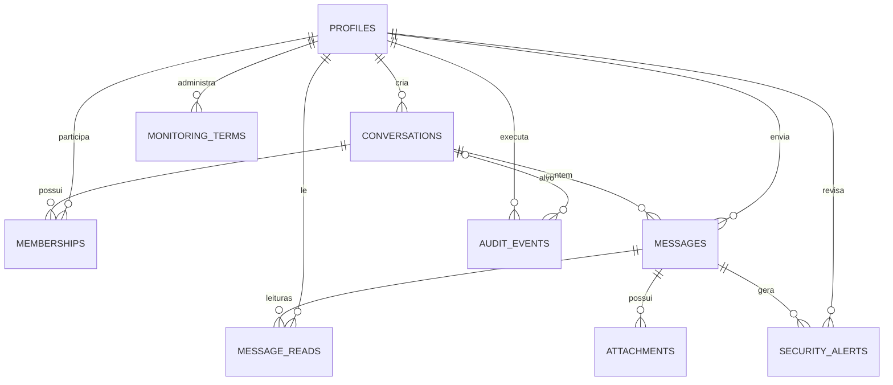

# Modelo de dados — Polychat

- **Identificador:** POLY-DATA-001
- **Versão:** 0.3 — 19/11/2026
- **Status:** modelo lógico atualizado para a baseline FORD v2; revisão física/técnica pendente
- **Issue de referência:** #99 — Modelar schema PostgreSQL e migrations iniciais
- **ADR relacionada:** ADR-005 — Banco de dados e modelo de dados
- **Tecnologia oficial:** PostgreSQL via Supabase Database
- **Dependência técnica:** Q-025 — validação de projetos, regiões, ambientes e configuração Supabase/Vercel

> Este documento consolida o modelo lógico à luz da baseline POLY-REQ-001 v0.4. Supabase é a plataforma oficial de backend do Polychat; o documento não aprova por si só DDL, migrations ou RLS de domínio. A migration existente é uma fundação parcial, não evidência de implementação completa. Serviços externos adicionais exigem aprovação explícita.

## 1. Objetivo

Definir as entidades lógicas, atributos candidatos, relacionamentos, invariantes e rastreabilidade necessários ao MVP, separando requisitos funcionais confirmados de decisões físicas ainda sujeitas à revisão do Tech Lead, backend, TI e SQA.

## 2. Escopo e fontes

O modelo considera:

- POLY-REQ-001 v0.4 e o questionário FORD v2;
- RF-001 a RF-023, RN-001 a RN-025 e RNF-001 a RNF-013;
- ADR-005, atualizada para PostgreSQL via Supabase Database;
- matriz de autorização da Issue #100, com parecer funcional do PO registrado;
- política de anexos e antimalware, atualizada conforme limites e regras da FORD v2;
- documentos de auditoria, monitoramento e retenção;
- artefatos existentes no repositório, identificados conforme seu grau de implementação e cobertura, sem classificar Supabase como legado.

### 2.1 Convenção de status

| Status | Significado |
|---|---|
| **Requisito confirmado** | Regra funcional consolidada na FORD v2 ou alinhamento formal do PO com Desenvolvimento. |
| **Estrutura lógica proposta** | Entidade/atributo necessário para suportar o requisito; nomes e tipos físicos ainda podem mudar. |
| **Implementação parcial** | Código ou migration existente na stack oficial, mas ainda sem cobertura funcional completa ou integração comprovada. |
| **Revisão técnica pendente** | Requer decisão sobre tipos, chaves, índices, constraints, transações, RLS ou implantação. |
| **Pendente de escopo** | Informação funcional ainda não detalhada, como telas/parametrização persistente não inventariada. |

## 3. Premissas e limites

1. O banco lógico é relacional; PostgreSQL via Supabase Database é a tecnologia oficial de persistência, com administração dos projetos, acessos, backups e políticas sob governança da FORD.
2. Supabase é a plataforma oficial de backend. Os serviços Database/Auth/Storage/Realtime são detalhados nas ADRs 004 a 008; Q-025 verifica projetos, regiões e configurações por ambiente, não a escolha da plataforma.
3. O escopo inicial é uma única organização (FORD), sem multi-tenancy ou `tenant_id` adicional.
4. Os únicos perfis de aplicação são `user` e `ti`. Todos os administradores TI possuem poderes equivalentes; não criar administrador principal, owner ou moderator.
5. Contas são criadas exclusivamente pelo TI. O nome de usuário é único e pode ser definido/alterado pelo TI. A senha é criada e enviada individualmente pelo TI; recuperação é exclusiva do TI.
6. Conversas individuais e grupos são entidades de domínio. O TI cria, encerra, desativa e reativa grupos e administra seus participantes.
7. Usuários podem ler somente conversas das quais sejam participantes; usuários incluídos no grupo podem enviar mensagens. Usuários não podem sair voluntariamente dos grupos. A remoção pelo TI revoga imediatamente acesso às mensagens e anexos anteriores do grupo.
8. Usuários não podem editar ou excluir mensagens. TI pode editar ou excluir mensagens a qualquer momento; operações devem ser auditadas.
9. O sistema registra confirmação/horário de leitura e quantidade de mensagens não lidas.
10. Anexos são PDF/JPEG, até 10 MB por arquivo e até 5 arquivos por mensagem. O TI define quotas individuais e capacidade total; não existe quota por conversa.
11. Anexos são analisados por antimalware integrado à stack oficial antes da disponibilização; não utilizar scanner externo não aprovado. Falha ou resultado inconclusivo mantém o anexo bloqueado para o fluxo normal. TI pode liberar qualquer anexo por ação administrativa auditada.
12. Mensagens, anexos, alertas, logs de auditoria e registros administrativos não sofrem exclusão automática enquanto o sistema opera. Exclusões são autorizadas pelo TI; backups diários são retidos por 12 meses.
13. A consulta de conversas pelo TI é permitida a qualquer momento, sem justificativa ou segunda aprovação, e deve ser auditada. Exportação de conversas também é permitida e auditada.
14. A detecção de conteúdo suspeito é baseada em regras/lista de termos gerida pelo TI, sem análise contextual ou IA/serviço externo não aprovado e sem bloqueio automático de mensagem.
15. O modelo deste documento é lógico. Não aplicar migrations nem declarar RLS de domínio implementada apenas com base nesta documentação.

## 4. Diagrama lógico preliminar

O diagrama representa entidades e relacionamentos lógicos. Não é DER físico aprovado. A autenticação utiliza Supabase Auth; o modelo interno de contas/perfis relaciona-se à identidade autenticada por referência estável, sem expor os identificadores do provedor como identificadores de negócio.

### 4.1 Leitura do diagrama

- `profiles` representa a conta/perfil interno do Polychat e mantém referência à identidade Supabase Auth correspondente.
- `memberships` representa participação, distinta da role.
- `message_reads` é uma estrutura lógica candidata para recibo/horário de leitura por mensagem e destinatário; a solução física pode usar outra estrutura se preservar os requisitos.
- `attachments` guarda metadados e referência privada do objeto; os bytes ficam em bucket privado do Supabase Storage.
- `audit_events` registra ações administrativas e de segurança.
- `security_alerts` representa alertas produzidos pela lista de termos.
- `monitoring_terms` representa a lista de termos/regras administrada pelo TI. Não é uma tabela genérica de configurações.

## 5. Entidades e dicionário de dados lógico

Os campos abaixo são candidatos lógicos. Tipos SQL, constraints, chaves e índices devem ser validados antes de migrations.

### 5.1 profiles — contas e perfis

**Requisitos confirmados:** RF-001 a RF-004; RN-001 a RN-005.

| Campo lógico | Obrigatoriedade | Regra |
|---|---|---|
| id | Obrigatório | Identificador interno estável da conta. |
| username | Obrigatório | Nome de usuário único na organização; definido e alterável pelo TI. |
| role | Obrigatório | Somente `user` ou `ti`. |
| is_active | Obrigatório | Estado da conta. Desativação revoga sessões imediatamente; reativação é feita pelo TI. |
| credential_reference / credencial protegida | Dependente da solução de identidade | A senha é gerenciada pelo Supabase Auth; o banco de domínio não armazena senha em texto puro. |
| created_at / updated_at | Recomendado | Datas de criação e atualização. |

**Regras:**
- TI cria todas as contas, inclusive as contas TI.
- TI cria a senha e envia individualmente junto ao link de acesso.
- Recuperação de senha é exclusiva do TI.
- A FORD não exige troca obrigatória no primeiro acesso, expiração periódica ou MFA para este MVP.
- Não há auto cadastro, autoinscrição ou alteração de role pelo usuário.
- Todos os perfis TI possuem os mesmos poderes.
- A desativação encerra imediatamente as sessões, preservando o histórico.

**Implementação parcial existente:** a migration `supabase/migrations/202611160001_profiles_roles_and_account_status.sql` cria `profiles` vinculado a `auth.users` no Supabase Auth. O artefato integra a stack oficial, mas cobre apenas perfis; deve ser evoluído com as entidades de domínio e políticas RLS correspondentes.

### 5.2 conversations — conversas individuais e grupos

**Requisitos confirmados:** RF-005, RF-007 a RF-010, RF-016, RF-021; RN-006, RN-007 e RN-014.

| Campo lógico | Obrigatoriedade | Regra |
|---|---|---|
| id | Obrigatório | Identificador interno estável. |
| kind | Obrigatório | Tipo individual ou grupo. |
| name | Condicional | Identificação do grupo, quando aplicável. |
| created_by_profile_id | Obrigatório | Conta que iniciou a criação; grupos são criados pelo TI. |
| status | Obrigatório | Deve representar ativo, desativado ou encerrado conforme operações do TI. |
| created_at / updated_at | Recomendado | Datas de criação/atualização. |
| ended_at / status_changed_at | Condicional | Histórico de encerramento/desativação/reativação, conforme desenho técnico. |

**Regras:**
- TI cria, encerra, desativa e reativa grupos.
- TI administra a inclusão e remoção de participantes.
- O TI pode consultar qualquer conversa a qualquer momento, sem justificativa ou segunda aprovação; consulta auditada.
- O TI pode exportar conversas, com auditoria.
- Usuários comuns acessam somente conversas das quais participem.
- A consulta TI não transforma o administrador em participante.
- Unicidade de conversa individual por par, arquivamento de conversas individuais e estados físicos adicionais não devem ser inventados sem decisão.

### 5.3 memberships — participação

**Requisitos confirmados:** RF-005, RF-006, RF-008, RF-010; RN-007.

| Campo lógico | Obrigatoriedade | Regra |
|---|---|---|
| id | Obrigatório | Identificador interno. |
| conversation_id | Obrigatório | Referência à conversa. |
| profile_id | Obrigatório | Referência ao participante. |
| added_by_profile_id | Obrigatório para inclusão administrativa | Deve identificar o TI que incluiu o participante. |
| joined_at | Obrigatório | Momento da entrada. |
| removed_at | Condicional | Momento da remoção pelo TI. |
| removed_by_profile_id | Condicional | TI que removeu o participante. |
| membership_status | Obrigatório | Indica participação vigente ou encerrada. |

**Regras:**
- TI inclui e remove participantes.
- Usuário não pode sair voluntariamente de grupo.
- Ao remover participante, acesso às mensagens e anexos anteriores do grupo é revogado imediatamente.
- Não excluir o registro de membership apenas para remover acesso; preservar evidência histórica de quem participou e quem efetuou a remoção.
- Membership não cria papel de autorização adicional.
- Enviar/ler em grupo depende de membership vigente; TI possui exceção de consulta administrativa descrita em RF-016.

### 5.4 messages — mensagens

**Requisitos confirmados:** RF-008 a RF-010, RF-019, RF-020; RN-006, RN-007 e RN-014.

| Campo lógico | Obrigatoriedade | Regra |
|---|---|---|
| id | Obrigatório | Identificador interno. |
| conversation_id | Obrigatório | Conversa de origem. |
| sender_profile_id | Obrigatório | Autor; derivado da identidade validada no servidor. |
| body | Conforme formato da mensagem | Conteúdo textual. A possibilidade de mensagem composta somente por anexo deve ser validada no fluxo técnico/UX, sem alterar as regras de anexo. |
| created_at | Obrigatório | Horário de criação/registro confirmado pelo servidor. |
| edited_at / edited_by_profile_id | Condicional | Registra edição administrativa de mensagem pelo TI. |
| deleted_at / deleted_by_profile_id | Condicional | Registra exclusão administrativa pelo TI, conforme política técnica de preservação. |

**Regras:**
- Usuários enviam mensagens em conversas individuais e grupos dos quais sejam participantes autorizados.
- Usuários não podem editar ou excluir mensagens.
- TI pode editar ou excluir qualquer mensagem a qualquer momento.
- Edição/exclusão administrativa deve gerar evento de auditoria.
- Mensagens confirmadas pelo servidor devem ser persistidas e recuperadas após reconexão normal. RPO de 24 horas aplica-se somente a desastre/falha de infraestrutura.
- Não definir exclusão automática nem cascata que elimine histórico sem autorização do TI e sem observar retenção/investigações.

### 5.5 message_reads — confirmações e horários de leitura

**Requisito confirmado:** RF-019.

| Campo lógico | Obrigatoriedade | Regra |
|---|---|---|
| id | Obrigatório | Identificador interno ou chave composta equivalente. |
| message_id | Obrigatório | Mensagem lida. |
| profile_id | Obrigatório | Destinatário/leitor. |
| read_at | Obrigatório quando lida | Data/hora de leitura. |

**Regras:**
- O sistema deve permitir confirmação de leitura e horário de leitura.
- O sistema deve calcular/exibir a quantidade de mensagens não lidas.
- A estrutura física pode usar tabela de recibos, cursor de leitura ou abordagem híbrida; a decisão deve preservar confirmação/horário por mensagem e contador de não lidas.
- Não confundir confirmação de leitura com entrega ou confirmação de persistência.

### 5.6 attachments — metadados dos anexos

**Requisitos confirmados:** RF-011 a RF-013; RN-008, RN-011; RNF-010.

| Campo lógico | Obrigatoriedade | Regra |
|---|---|---|
| id | Obrigatório | Identificador interno. |
| message_id | Obrigatório | Mensagem vinculada. |
| storage_object_key | Obrigatório | Referência privada ao objeto, sem URL pública permanente. |
| original_filename | Obrigatório | Nome tratado/normalizado; entrada do cliente não confiável. |
| detected_mime_type | Obrigatório | Tipo real detectado no servidor, restrito a PDF/JPEG. |
| size_bytes | Obrigatório | Tamanho real em bytes. |
| scan_status | Obrigatório | Pendente, aprovado, bloqueado/reprovado ou inconclusivo, conforme modelo técnico. |
| scan_result / scanned_at | Condicional | Resultado e instante da análise. |
| released_by_profile_id / released_at | Condicional | Ação administrativa de liberação realizada pelo TI. |
| metadata_removed_at | Condicional | Evidência de remoção de EXIF/GPS da imagem. |
| created_at | Obrigatório | Instante de recebimento. |

**Regras:**
- PDF e JPEG são os únicos formatos aceitos.
- Máximo 10 MB por arquivo e até 5 arquivos por mensagem.
- TI define quotas individuais e capacidade total; não existe limite por conversa.
- PDF protegido por senha é rejeitado.
- JPEG é selecionado da galeria; não há captura por câmera. Metadados EXIF/GPS são removidos.
- Análise antimalware deve ser executada no fluxo controlado do Polychat, integrado ao armazenamento privado Supabase.
- Falha, indisponibilidade ou inconclusão mantém o anexo bloqueado no fluxo normal; mensagem de texto continua funcionando.
- TI pode liberar qualquer anexo por operação administrativa auditada. Usuários não podem contornar a análise.
- TI pode baixar anexos durante investigações; o download é auditado.
- Links temporários têm validade máxima de 5 minutos e a remoção de participante revoga imediatamente o acesso.
- O armazenamento binário fica fora das tabelas, em bucket privado do Supabase Storage.

### 5.7 security_alerts — alertas de conteúdo suspeito

**Requisitos confirmados:** RF-014/RF-015; RN-012/RN-013.

| Campo lógico | Obrigatoriedade | Regra |
|---|---|---|
| id | Obrigatório | Identificador do alerta. |
| message_id | Obrigatório | Mensagem que originou o alerta. |
| matched_rule / term_reference | Obrigatório | Referência à regra/lista aplicada; não é necessário duplicar texto integral do conteúdo. |
| severity | Obrigatório | Baixa, média ou alta. |
| created_at | Obrigatório | Momento da sinalização. |
| status | Obrigatório | Aberto/em análise/encerrado, ou estados equivalentes. |
| reviewed_by_profile_id | Condicional | TI que analisou/encerrou. |
| reviewed_at / closed_at | Condicional | Datas do tratamento/encerramento. |

**Regras:**
- A detecção usa regras e lista de termos mantida pelo TI, incluindo palavrões.
- Não há análise contextual ou IA externa.
- A detecção não bloqueia automaticamente mensagem ou conta.
- A fila TI prioriza severidade e prazo: alta imediata (até 1h), média até 1 dia útil, baixa até 3 dias úteis.
- TI pode encerrar alerta sem justificativa obrigatória.

### 5.8 monitoring_terms — lista de termos/regras

**Necessidade funcional confirmada:** o TI mantém a lista de termos/regras de detecção.

A estrutura lógica deve permitir manter os termos habilitados, sua regra/categoria e o histórico mínimo de administração necessário. Campos físicos (por exemplo, termo, status, versão, criado/alterado por e timestamps) são candidatos e devem ser revistos tecnicamente. Não criar uma tabela genérica de configurações para armazenar qualquer parâmetro sem inventário.

A lista e o processamento devem permanecer nos componentes oficiais Supabase/Vercel. Nenhum texto de mensagem pode ser enviado a serviços externos adicionais ou ferramentas de IA não aprovadas.

### 5.9 audit_events — eventos de auditoria

**Requisitos confirmados:** RF-022; RNF-004; RN-014, RN-021 e RN-025.

| Campo lógico | Obrigatoriedade | Regra |
|---|---|---|
| id | Obrigatório | Identificador do evento. |
| actor_profile_id | Obrigatório para ação administrativa | Operador responsável. |
| event_type | Obrigatório | Tipo de ação executada. |
| resource_type / resource_id | Obrigatório conforme evento | Recurso afetado. |
| occurred_at | Obrigatório | Instante gerado em contexto confiável. |
| metadata | Condicional | Dados mínimos para rastreabilidade; sem senhas, tokens, chaves ou conteúdo integral. |

**Catálogo funcional mínimo:**
- login administrativo;
- criação/alteração/desativação/reativação de contas;
- criação/encerramento/desativação/reativação de grupos;
- inclusão/remoção de participantes;
- consulta administrativa de conversas;
- consulta e encerramento de alertas;
- download e liberação administrativa de anexos;
- exportação de conversas;
- edição/exclusão administrativa de mensagens;
- alteração de configurações.

**Regras:**
- Operações administrativas listadas devem ser registradas.
- Somente TI consulta e gerencia registros; Usuários não consultam, alteram ou excluem.
- Os registros não sofrem exclusão automática enquanto o sistema operar.
- Exclusões autorizadas e descarte após ciclo de backup são registrados.
- Consulta administrativa não exige campo justificativa obrigatório.
- O desenho deve impedir que uma falha de auditoria resulte em operação administrativa sem rastreabilidade.

### 5.10 Configurações persistentes

Não criar uma tabela genérica `configs` sem inventário. As configurações funcionais confirmadas incluem a lista de termos/regras e parâmetros administrados pelo TI. Outras configurações de UX/deploy ou segredos operacionais não devem ser presumidas como dados de negócio. Segredos e chaves permanecem em mecanismos seguros de configuração/segredos associados aos serviços oficiais, sob governança da FORD; nunca em tabela genérica ou no repositório.

## 6. Relacionamentos e invariantes

| Origem | Relação | Destino | Cardinalidade lógica |
|---|---|---|---|
| profiles | cria | conversations | 1:N |
| conversations | possui | memberships | 1:N |
| profiles | participa por | memberships | 1:N |
| conversations | contém | messages | 1:N |
| profiles | envia | messages | 1:N |
| messages | recebe confirmações | message_reads | 1:N |
| profiles | registra leitura | message_reads | 1:N |
| messages | possui | attachments | 1:N |
| messages | pode gerar | security_alerts | 1:N |
| profiles | revisa | security_alerts | 1:N |
| profiles | administra | monitoring_terms | 1:N |
| profiles | executa | audit_events | 1:N |

Invariantes:
- Mensagem pertence a uma conversa e tem autor validado no servidor.
- Anexo pertence a uma mensagem.
- Usuário só lê conversas em que seja participante autorizado.
- Membro incluído pelo TI pode enviar mensagens ao grupo; não membro não pode ler nem enviar.
- Remoção de participante revoga acesso ao histórico e anexos anteriores.
- TI pode consultar conversas sem membership, mas a consulta é auditada.
- Nenhuma role adicional é criada para participantes.
- Desativação de conta, remoção de membership e encerramento de grupo não implicam exclusão automática do histórico.

## 7. Constraints, integridade e índices candidatos

Propostas para revisão técnica:
- unicidade de `username` normalizado;
- CHECK de role limitada a `user` e `ti`;
- CHECK de conversa individual/grupo;
- FK de membership para perfil e conversa;
- unicidade de membership ativa por perfil/conversa, considerando histórico;
- FK de mensagem para conversa e autor;
- FK de recibo de leitura para mensagem e perfil, com unicidade por mensagem/perfil;
- validação de MIME/tamanho do anexo no servidor; constraints não substituem inspeção do conteúdo;
- evento de consulta administrativa deve identificar operador, conversa-alvo e horário;
- não usar cascatas destrutivas incompatíveis com retenção e preservação de histórico.

Índices candidatos: `memberships(profile_id, conversation_id)`, `memberships(conversation_id, profile_id)`, `messages(conversation_id, created_at)`, `message_reads(profile_id, message_id)`, `attachments(message_id)`, `audit_events(actor_profile_id, occurred_at)` e `audit_events(resource_type, resource_id, occurred_at)`. Índices finais dependem de consultas e metas de carga alinhadas.

## 8. Segurança, autorização e RLS

- A matriz da Issue #100 define os atores e regras funcionais; o parecer funcional do PO foi registrado em comentário da issue.
- A implementação RLS de domínio e testes de isolamento pertencem também à Issue #101.
- Autenticação, autorização e armazenamento utilizam Supabase Auth/Database/Storage, com políticas e acessos sob governança da FORD.
- Autorização server-side é obrigatória; RLS no banco é defesa adicional quando suportada pela implantação.
- Role, estado e membership não podem ser aceitos de dados enviados livremente pelo navegador.
- Negar por padrão quando identidade, membership ou permissão não puderem ser verificadas.
- TI tem exceções administrativas explicitamente definidas para consulta/exportação, administração de mensagens, anexos, alertas e auditoria, todas rastreáveis.
- A migration Supabase existente só cobre `profiles`; não comprova RLS de domínio nem define sozinha o modelo final.

## 9. Retenção, exclusão e histórico

- Mensagens, anexos, alertas, logs de auditoria e registros administrativos não sofrem exclusão automática enquanto o sistema operar.
- O TI autoriza exclusões e decide quando preservar informações durante investigações.
- Backups diários são retidos por 12 meses.
- Após exclusão autorizada, os dados saem dos backups ao final do ciclo de retenção; o descarte é registrado em auditoria.
- Desativação de conta e remoção de participante não são exclusão de dados.
- O modelo físico deve suportar preservação e descarte autorizado sem perda não intencional de histórico.

## 10. Rastreabilidade atualizada

| Entidade | Requisitos principais |
|---|---|
| profiles | RF-001 a RF-004; RN-001 a RN-005 |
| conversations | RF-005, RF-007 a RF-010, RF-016, RF-021 |
| memberships | RF-005, RF-006, RF-008, RF-010, RF-019 |
| messages | RF-008 a RF-010, RF-019, RF-020 |
| message_reads | RF-019 |
| attachments | RF-011 a RF-013; RN-008/RN-011; RNF-010 |
| security_alerts | RF-014/RF-015; RN-012/RN-013 |
| monitoring_terms | Lista de termos/regras administrada pelo TI; RN-012 |
| audit_events | RF-016, RF-020 a RF-022; RNF-004 |

## 11. Questões e estado na baseline v0.4

| Questão | Estado atual | Impacto residual |
|---|---|---|
| Q-003 — grupos, saída/remoção | Respondida pela FORD v2 | TI administra grupos e membros; usuário não sai voluntariamente; remoção revoga acesso ao histórico e anexos |
| Q-005 — identificador de login | Respondida | username único, definido/alterado pelo TI |
| Q-007/Q-008 — regras e alertas | Respondidas/alinhadas | lista de termos do TI; severidade/prazos fixados; sem análise contextual ou bloqueio automático |
| Q-009/Q-010 — consulta/auditoria/retenção | Respondidas/alinhadas | consulta TI sem justificativa; auditoria catalogada; retenção e backups definidos |
| Q-011 — anexos | Respondida/alinhada | PDF/JPEG, 10 MB, 5 por mensagem, quotas TI, scanner interno integrado à stack oficial e comportamento fail-closed |
| Q-016 — desempenho/capacidade | Alinhada com Desenvolvimento | metas e capacidade constam dos requisitos técnicos; não reabrir como pendência de produto |
| Q-024 — edição/exclusão de mensagens | Respondida | Usuário não edita/exclui; TI pode editar/excluir com auditoria |
| Q-018/Q-019 | Parcialmente abertos | refinamento de telas/navegação e ativos oficiais de marca |
| Q-025 | Aberta | validação técnica dos projetos, regiões e ambientes da stack oficial Supabase/Vercel |

## 12. Validações e critérios para migrations

Antes de migrations:
- [ ] Tech Lead/backend revisam normalização, chaves, cardinalidades, constraints e índices.
- [ ] TI revisa administração de contas, grupos, consulta/exportação e auditoria.
- [ ] Matriz #100 e revisão independente SQA são consideradas; o parecer funcional do PO não substitui SQA.
- [ ] Estratégia de autorização/RLS e testes negativos de domínio são aprovados.
- [ ] Os projetos Supabase/Vercel, regiões, políticas RLS, storage privado e integrações são validados conforme a Q-025 e ADRs revisadas.
- [ ] Backup/restore e retenção são compatíveis com RN-021/RNF-009.
- [ ] A revisão ocorre por PR antes de aplicar migrations.

A documentação lógica não declara schema aprovado nem migrations executadas.

## 13. Histórico de revisões

| Versão | Data | Alteração | Estado |
|---|---|---|---|
| 0.1 | 18/11/2026 | Modelo lógico inicial. | Histórico |
| 0.2 | 19/11/2026 | Escopo funcional de entidades validado pelo PO. | Histórico |
| 0.3 | 19/11/2026 | Reconciliado com FORD v2, stack oficial Supabase/Vercel, recibos de leitura, auditoria ampliada, retenção, anexos e alertas. | Modelo lógico atualizado; revisão física pendente |

## 14. Referências

- [Baseline POLY-REQ-001 v0.4](../09-baseline-requisitos-mvp.md)
- [Issue #99 — Modelar schema e migrations](https://github.com/Aluvioz/Polychat/issues/99)
- [Issue #100 — Matriz de autorização](../issue-100-matriz-autorizacao.md)
- [Issue #101 — RLS e testes de isolamento](https://github.com/Aluvioz/Polychat/issues/101)
- [Issue #102 — Auditoria e retenção](https://github.com/Aluvioz/Polychat/issues/102)
- [ADR-005 — Banco de dados](../adr/ADR-005-dados-postgresql.md)
- [ADR-008 — Armazenamento e anexos](../adr/ADR-008-storage-anexos.md)
- [ADR-010 — Segurança, auditoria e monitoramento](../adr/ADR-010-seguranca-auditoria-monitoramento.md)
